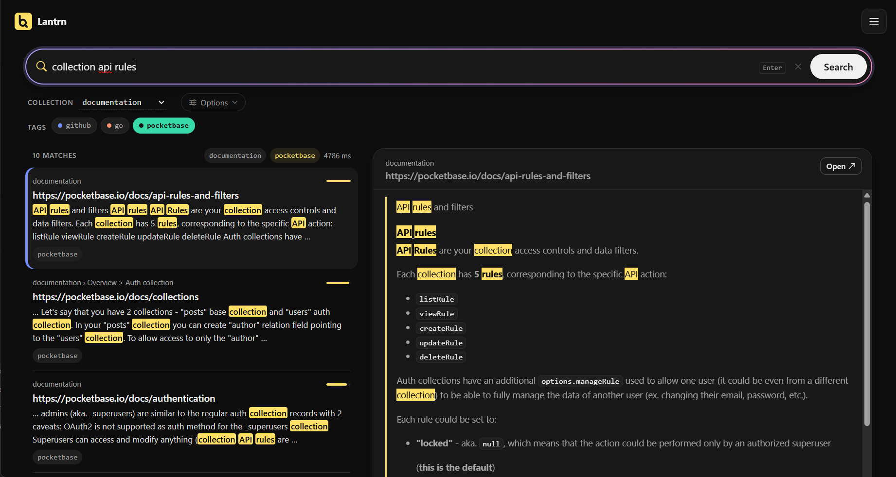

#  Lantrn

Self-hosted semantic search for your documents. Upload files or crawl a website, then search them by meaning. Optionally, a chat model answers from the results.

Built with Blazor Server, [Qdrant](https://qdrant.tech) and [Xberg](https://www.nuget.org/packages/XbergIo.Xberg). Works with any OpenAI-compatible model server (OpenAI, LM Studio, Ollama, vLLM).

**Docs: [viedin.github.io/lantrn](https://viedin.github.io/lantrn/)**



## Features

- Hybrid search: embeddings plus keyword matching
- PDF, Office, e-mail, e-books, Markdown, HTML, text, and images through a vision model
- Website and GitHub repository crawling, with scheduled re-syncs
- Collections and tags
- Optional LLM answers with citations
- Users, invites, private and public collections, OIDC single sign-on
- REST API and MCP server

## Quick start

```sh
curl -O https://raw.githubusercontent.com/Viedin/lantrn/main/Lantrn/docker-compose.yml
docker compose up -d
```

Open http://localhost:8080 and register. The first account becomes the admin. Then set your embedding model under **Settings**.

See the [docs](https://viedin.github.io/lantrn/) for configuration, SSO and [development](https://viedin.github.io/lantrn/guide/development).

## Loftbod

The root `loftbod.json` packages Lantrn with a private Qdrant service. Each has a 1 GiB memory limit, one CPU, and 4 GiB of persistent storage. Backups must include both volumes.

During installation, set the embedding endpoint and model. Use public HTTPS or a separate LAN machine running LM Studio (port 1234), vLLM (8000), or Ollama (11434). Loftbod blocks access to the host itself. Register the first account to become admin, then enter any model API keys in **Settings**. Never put keys in `loftbod.json`.

When publishing a new version, update `version` and the app image tag in `loftbod.json` before creating the matching GitHub release. The existing Docker workflow builds both supported architectures.

## Contributing

Pull requests are welcome.

## License

[MIT](LICENSE)
